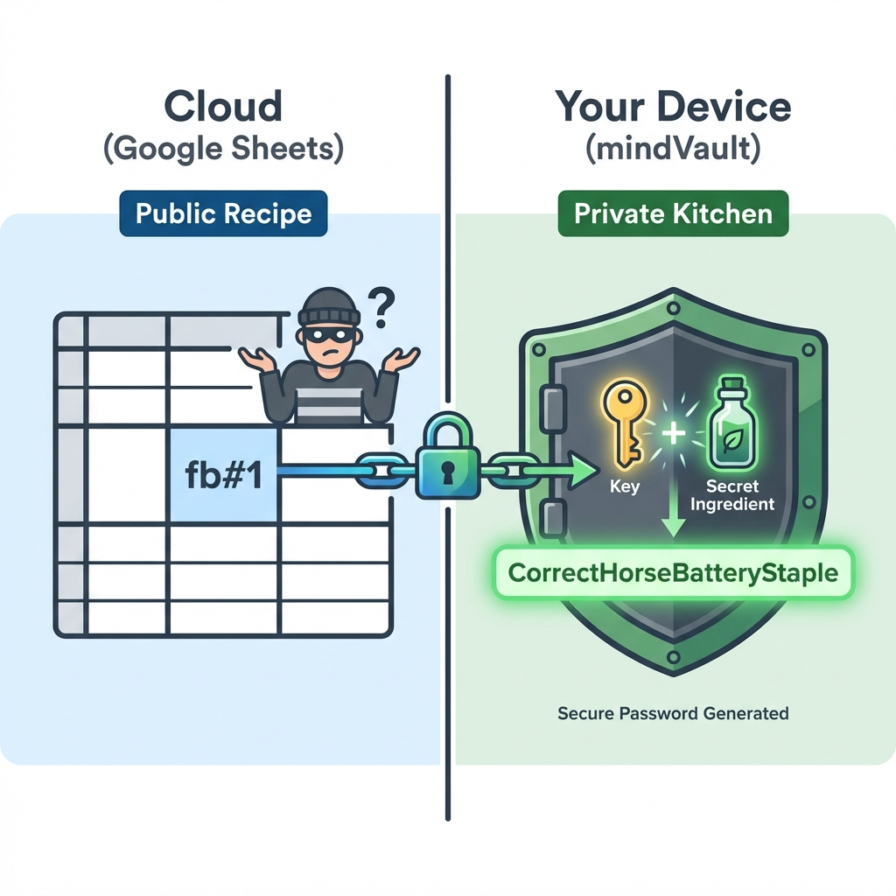

# PassChef Password Generator

**Turn Google Sheets into a Secure Password Manager**

> **Note:** This repository contains:
>
> 1. **[Chrome Extension](./chrome-extension)**: The main password manager tool.
> 2. **[Android Cookbook](./app)**: Manual cooking, offline Menu cache/mapping and Google connection code; the [Menu client](./mobile/sheets-client) also builds independently.
> 3. **[Landing Page](./landing-page)**: Marketing website.

PassChef is a Chrome Extension that allows you to generate strong, consistent passwords directly from your Google Sheets cells using a formula-based approach (e.g., `r4nd0m#1`). It uses **Argon2id** and **AES-256-GCM** to ensure your master secrets are secure.

## Why is this Safe? (The "Recipe" Insight)

> **Your Menu holds Recipes; your private Spices complete each Dish. Keep sensitive Menus private.**

### The Problem

> **Think like a Chef, not an Admin.**

Storing passwords in Google Sheets is like leaving cooked food out in the open. Anyone who finds it can eat it.

### The "Cookbook" Solution

Instead of storing the food (Password), we only store the **Recipe**.

- **Part 1 (The Menu)**: Publicly visible in your sheet. e.g., "Facebook: **r4nd0m`#1`**".
- **Part 2 (The Secret Spice)**: A private phrase, protected in the encrypted Cookbook. e.g., synthetic "Spice #1 is `Basic*`".

When you need to log in, you become the Chef. You look at the menu (`r4nd0m#1`), take the ingredients (`r4nd0m`), and add your secret spice (`Basic*`) according to the instructions (`#` = put spice on top).

**Result**: The synthetic Dish `Basic*r4nd0m`, cooked when needed. Choose strong, unpredictable ingredients and Spices for real accounts.

### Why It Works

**Separate ingredients**: A Menu contains Recipes rather than cooked Dishes. It can still expose account names, ingredient patterns and Tags; weak Spices can be guessed. Keep sensitive Menus private.
**Convenience**: You manage a whole menu of 100+ accounts but only need to remember few jars of spices.
**Taste Control**: Need to change a password? Just tweak the ingredient text (e.g. `r4nd0m` → `r4nd0m2`) — same secret, new password.
**Freshness**: Dishes are cooked on demand; the extension stores encrypted Spices rather than a list of cooked passwords. Dishes can still exist in memory and on the clipboard.

### The Recipe (Math)

```
What's on your sheet: r4nd0m`#1`
What you remember: `Basic*`
Your actual password: `Basic*r4nd0m`
```

_A simple Recipe model. Protection depends on strong credentials and a trusted device._



## Features

- 🔐 **Encrypted Cookbook**: Argon2id derives the key from your master password; AES-256-GCM protects stored Spices. Encrypted profiles use Chrome Sync, with some readable metadata. Session keys use session storage; nonsecret counters/onboarding use local storage.
- ⚡ **On-demand cooking**: Select a Recipe cell (e.g., `fb#1`), then open the extension or use its shortcut to cook a Dish.
- ⌨️ **Hotkey Support**: Press `Ctrl+Shift+L` (or `Control+Shift+L` on Mac, subject to browser conflicts) to cook from the focused cell.
- 📋 **Clipboard cleanup**: After Copy, cleanup is attempted at 30 seconds only if the clipboard still matches the owned Dish. Read denial, sleeping/closed Chrome, OS history and concurrent app writes limit this guarantee.
- 🔒 **Auto-Lock**: Automatically locks after 5 minutes of inactivity or 10 minutes total.
- 🌍 **Localization**: Supports English and **Vietnamese**.

                 |

## Core Documentations

- [Master execution plan and detailed tracks](plans/261022-project-work-queue/plan.md)

- [Password System Design](./docs/password-system-design.md)
- [Product Requirements Document (PRD)](./docs/prd.md)
- [Security Assessment](./docs/security-assessment.md)
- [Commercialization Documentation](./docs/commercialization/README.md)

## Installation (Developer Mode)

1. **Clone or Download** this repository.
2. Open Chrome and navigate to `chrome://extensions/`.
3. Enable **Developer mode** (top right toggle).
4. Click **Load unpacked**.
5. Select the `src` folder inside `chrome-extension` (e.g., `./chrome-extension/src`).

## Usage

### 1. Setup

- Click the extension icon.
- Create a strong **Master Password**. This is used to encrypt your secret phrases.
- **Important**: If you lose this password, you lose access to your secrets. There is no reset.

### 2. Configure Secrets

- Enter up to 5 secret phrases corresponding to different modifiers:
  - `1` (Prefix `#`): e.g., "MySecretPrefix"
  - `2` (Middle `@`): e.g., "MySecretMiddle"
  - ...
- Save your changes.

### 3. Generate Passwords

- Open any Google Sheet.
- Type a formula into a cell, e.g., `fb#1` (Service: fb, Modifier: #, Secret Index: 1).
- **Select the cell and open the extension** OR press `Ctrl+Shift+L`.
- A popup will appear with your generated password. Click **Copy**.

## Recipe Syntax

`<Ingredient><CookingStyle><SpiceIndex>[Modifiers][.<VerifyTag>]`

- **Ingredient**: ASCII letters and digits (e.g., `f3c4b00k`, `r4nd0m`). Use unpredictable text for real accounts.
- **Cooking Style** (Modifier):
  - `#`: **Topping** (Prefix Secret)
  - `@`: **Filling** (Middle Secret)
  - `$`: **Base** (Suffix Secret)
  - `%`: **Mix** (Interleaved)
  - `^`: **Sandwich** (Paired)
- **Spice Index**: 1-5 (Which secret jar to use).
- **Modifiers** (Optional): `_` flip position, `!` uppercase, `?` reverse, `~` strip special chars.
- **Verify Tag** (Optional, 4 chars): `.xxxx` suffix produced by the popup Recipe Builder. Catches profile/sheet mismatches at decode time.

Example: `gmail@2` (legacy) or `gmail@2.a4b2` (with verify tag).

### Verify Tag — what it is, what it isn't

The optional `.tag` suffix is **verification metadata only**. It does NOT change the Dish. For own profiles, you can still cook by hand using the Recipe minus the Tag:

```
Recipe on sheet:  r4nd0m#1.a4b2
You ignore tag → r4nd0m + spice #1 (Basic*)  →  Basic*r4nd0m
```

If a present Tag does not match the Recipe, Spice and Menu context, the extension **refuses to cook** with an explicit error. Untagged legacy Recipes remain usable with guidance; removing a Tag removes its check. The four-character HMAC Tag does not change the Dish or guarantee protection against tampering. A visible Tag can help test guessed weak Spices offline. See [`docs/recipe-tag-design-rationale.md`](./docs/recipe-tag-design-rationale.md) for the own-profile binding decision; these current boundaries qualify its historical security wording.

Full Access export/QR transfers the original profile Spices inside a bundle encrypted with a separate sharing password. A recipient with both can recover those Spices and cook the same Dishes. Share only with someone you authorize. Legacy sheet-bound sharing uses additional derivation and is a different mode.

Malware, phishing, weak credentials and clipboard capture remain risks. Historical bounded browser acceptance does not establish cross-device Sync/conflict recovery, a broad platform matrix or final release artifact acceptance; see the [current browser contract](./docs/specs/extension-security.md).

> **Rotating a password?** Change the ingredient text (`gmail@2` → `gmail2@2`). Avoid leaking a rotation pattern like `_v2` that hints earlier versions exist.

## Development

### Mobile foundation

The independent [Kotlin Menu client](mobile/sheets-client) reads and updates
recipes through Google Sheets API. The [OAuth setup guide](docs/runbooks/google-oauth-sheets-setup.md)
explains the manual Google connection. Current integration progress and the
remaining mobile tracks are recorded in [worktree recovery](docs/worktree-recovery.md).
The desktop live connection check remains pending; selected Android Google
grant/read/mapping/cache-file acceptance passed on Xiaomi/API36.

Build and test with **JDK 21**, replacing the example JDK path:

```bash
export JAVA_HOME=/path/to/jdk-21
export PATH="$JAVA_HOME/bin:$PATH"
cd mobile/sheets-client
./gradlew build test
```

### Shared recipe kitchen

The Android/JVM [shared kitchen](shared/) ports recipe cooking and opens the
extension's full-access bundles. Its [spec](docs/specs/mobile-core.md) and
[recovery report](archive/plans/passchef-mobile/reports/mobile-core-recovery.md)
record acceptance and limits. The Menu client above retains its independent build; the root Android bridge reuses its canonical common sources.

From the repo root with JDK 17 and Android SDK platform 36 installed:

```bash
export JAVA_HOME=/path/to/jdk-17
export ANDROID_HOME=/path/to/android-sdk
export PATH="$JAVA_HOME/bin:$PATH"
./gradlew :shared:jvmTest :shared:assemble
```

### Android Cookbook

The [Android app](app/) connects its encrypted Cookbook to manual Recipe cooking,
confirmed Menu columns, private offline snapshots, search/favorites and masked
reveal/copy. The root `:sheets-android` bridge shares the portable Menu client;
explicit Connect uses Google's Android authorization flow. Cached account metadata
is app-private and excluded from backup, but is not encrypted.

The existing strong-biometric/original-password foundation and five-minute idle /
ten-minute total lock remain. Debug uses `dev.passchef.mobile.demo` separately from
release. Selected Xiaomi/API36 Cook/reveal and foreground clipboard checks passed,
including clipboard cleanup through Activity recreation. Selected authenticated
[owner-Copy screen-off01](plans/261012-mobile-cookbook-phase1/reports/owner-screen-off-clipboard-runtime.md)
passed sampled35s screen-off and same-Activity legal-return clipboard cleanup;
authenticated recreation/process-death/history and exact background30s
remain unaccepted.
The [focused clipboard repair](plans/261012-mobile-cookbook-phase1/reports/cross-app-clipboard-runtime.md)
passed JVM10 and4 unchanged physical adapter/recreation regressions. The subsequent
[null-label investigation and repair](plans/261012-mobile-cookbook-phase1/reports/clipboard-null-label-repair-runtime.md)
confirmed an actual Chrome null label triggered the original comparison's NPE.
The minimal null-safe comparison passed fresh build/JVM10 and five relevant physical
regressions and the unchanged strict Chrome-return case Passed99.870s: actual Chrome
replacement preserved and expired own metadata forgotten. Owner subsequently confirmed
the normal app stays open; prior proof-close timing remains unknown. Mobile stays Partial.
Selected Android Google grant/read/mapping/cache-file checks passed.
Google cache UI/Cook and authenticated same-process recreation passed
selected [cache UI Run02](plans/261012-mobile-cookbook-phase1/reports/google-cache-ui-runtime.md);
[network-off Run04](plans/261012-mobile-cookbook-phase1/reports/network-off-runtime.md)
also passed actual offline Cook and network-failure cache preservation.
Selected [real host Android Back](plans/261012-mobile-cookbook-phase1/reports/google-cancellation-preparation.md#actual-host-android-system-back-run01--passed)
passed external Google callback consumption after natural lock with synthetic offline
cache/jars preserved. Selected [actual Google HTTP403](plans/261012-mobile-cookbook-phase1/reports/google-http403-preparation.md#actual-google-http403-run04--passed27530s)
Passed27.530s with exact synthetic offline cache/jars preserved and stale Dish cleared.
Selected [provider-loaded403 + fresh cached Cook](plans/261012-mobile-cookbook-phase1/reports/google-provider403-preparation.md#actual-provider-loaded-http403-run01--passed21902s)
Run01 Passed21.902s: real Google-loaded cache/jars preserved exactly before a new
successful cached Cook. Human cancellation/resultCode,401/different-Menu callbacks,
LMK/task restoration remain Pending. Selected
[Google-loaded cache cold02](plans/261012-mobile-cookbook-phase1/reports/google-cold-runtime.md)
passed after verified SIGKILL and genuine biometric reopening. Historical Run01
reveal failure remains unexplained. See the [Cookbook contract](docs/specs/mobile-cookbook.md),
[execution evidence](plans/261012-mobile-cookbook-phase1/reports/verification.md),
[owner acceptance checklist](docs/runbooks/android-cookbook-acceptance.md) and
[remaining Keystore matrix](archive/plans/261011-keystore-recovery/reports/current-device-acceptance.md).
QR receiving, Autofill and account authoring remain later work.

With the same JDK17/SDK36 setup above:

```bash
./gradlew :shared:jvmTest :shared:assemble :sheets-android:jvmTest \
  :sheets-android:assemble :app:testDebugUnitTest :app:assembleDebug \
  :app:assembleDebugAndroidTest :app:assembleRelease :app:lintDebug
```

The test APK compiles real Compose/device assertions; compilation does not execute
those assertions. Local builds grant no Google access or device acceptance; authorized
selective phone runs are recorded separately in the acceptance reports.

### Extension development

- **Architecture**: Domain-Driven Design (DDD) with Clean Architecture.
- **Tech Stack**: Vanilla JS, Chrome Extensions Manifest V3.
- **Security**: Argon2 (WASM), Web Crypto API.

From `chrome-extension/`, with the locked pnpm development dependencies installed
(verified with Node24.18.0/pnpm10.24.0):

```bash
pnpm validate
pnpm test:package
pnpm package
pnpm validate:zip build/passchef-extension-2.3.1-development.zip
```

These commands validate the reviewed runtime inventory, local imports/resources,
mandatory Argon2 bytes and third-party notices, then create a development ZIP with
the manifest at its root plus SHA256/inventory sidecars in the ignored `build/`
folder. Missing or changed mandatory assets fail assembly; the four reviewed
legacy/unreferenced files listed in `scripts/package-contract.json` stay out of
the ZIP. Current Google Fonts CSS is recorded as external styling data separately
from executable resources. [Dated extracted-ZIP/full-suite and WASM evidence](plans/261022-project-work-queue/reports/b07-zip-suite.md),
[selected Windows measurements](plans/261022-project-work-queue/reports/b03-measurements-20261030.md)
and [local numeric upgrade evidence](plans/261022-project-work-queue/reports/b08-artifact-acceptance.md)
record actual scoped passes separately. Real two-device Sync,Store/final release
acceptance remain open;this held development artifact is not a release-accepted candidate.

## Testing

This project uses **Vitest** for Unit/Integration tests and **Playwright** for E2E tests.

### Running Tests

We support `npm`, `pnpm`, or `yarn`. Commands below use `pnpm` as recommended.

- **Run All Tests**:

  ```bash
  cd chrome-extension
  pnpm test
  ```

  _Runs Unit tests followed by E2E tests._

- **Unit Tests Only**:

  ```bash
  pnpm test:unit
  ```

- **E2E Tests Only**:
  ```bash
  pnpm test:e2e
  ```

### Test Protocols

- **Golden Tests**: Tests marked with `// @approved` are considered "Source of Truth". **Do not modify** them without explicit user approval.
