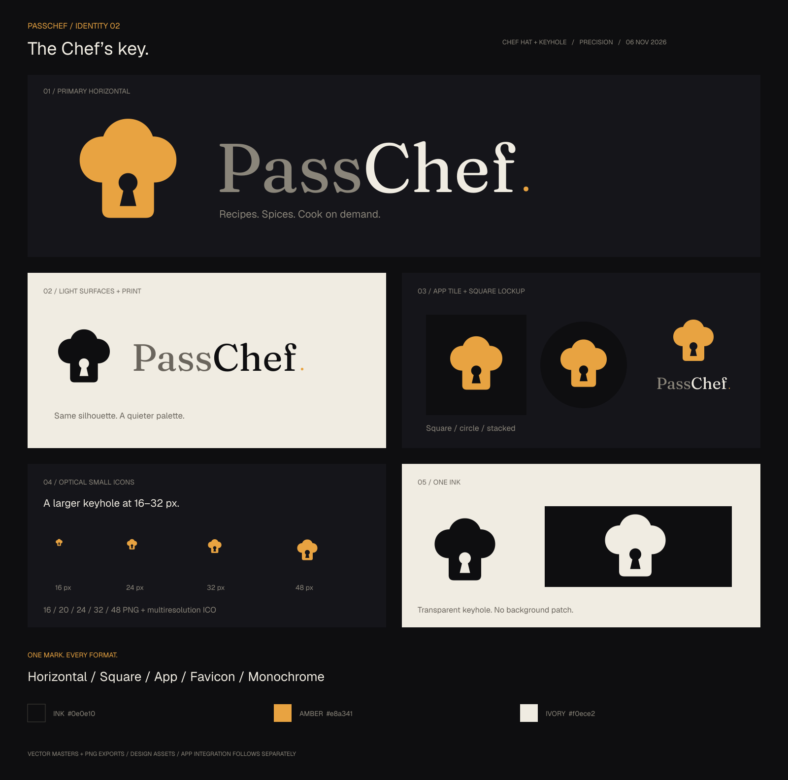

# PassChef — Chef's key / Identity 02

Owner direction:chef hat with a keyhole. Prepared2026-11-06 as a complete asset
proposal. Existing app,extension and website references are unchanged.



## Design

One filled,three-lobed chef hat. The keyhole is a genuine transparent opening,
not a background-colored overlay. Solid areas survive small screens and one-ink
printing. Amber `#e8a341`,ink `#0e0e10`,ivory `#f0ece2` follow Precision.
No neon glow,gradients,extra lock shackle or thin decorative lines.

Wordmark:Fraunces upright400;muted Pass,primary Chef and an amber signature dot.
Letters are shaped with HarfBuzz and converted to paths. SVG delivery requires
neither installed fonts nor remote resources. Light variants are for light
backgrounds/print;they do not introduce a new app theme.

## Choose an asset

| Use | Files | Notes |
|---|---|---|
| Header,banner,rectangle |`svg/passchef-horizontal-{dark,light}.svg`|Transparent;choose by surrounding background. PNG640/1280px wide.|
| Profile,square layout |`svg/passchef-square-{dark,light}.svg`|Transparent512×512 arrangement with wordmark. PNG512/1024.|
| Small toolbar/favicon |`svg/passchef-small-{amber,ink,ivory}.svg`|Optically enlarged keyhole. PNG16/20/24/32/48.|
| General standalone mark |`svg/passchef-mark-{amber,ink,ivory}.svg`|Standard96×96 geometry. PNG96/256/512/1024.|
| App/store tile |`svg/passchef-app-tile.svg`|Full-bleed square background;no baked rounded corners. PNG48–1024.|
| Android adaptive icon |`android/`|Separate native foreground/background;v33monochrome resource. Import-ready assets,not installed.|
| Single-ink printing |`svg/passchef-{horizontal,square}-mono-{ink,ivory}.svg`|Every part uses one ink;keyhole stays transparent.|
| Browser/Windows ICO |`passchef-favicon.ico`|16/24/32/48/64/128/256 frames;ink artwork for light browser chrome.|

`dark` means artwork for a dark surface,not an opaque dark rectangle.
`light` means artwork for a light surface. Only the app tile has a baked background.
Use amber/ivory marks on dark surfaces;ink marks on light surfaces. A universal
favicon color cannot contrast against every browser theme:choose appropriate
SVG colors through the consumer's theme handling when integrating.

## Spacing and size

- Keep at least16units of clear space around the96unit standalone mark.
  Delivered standalone SVGs have a tight artboard;add this clear space in layout.
- Horizontal minimum width160px;stacked minimum width160px. Below that,use the
  mark alone. Do not compress,stretch,rotate or rearrange the letters.
- At16–32px,use `small`;the enlarged keyhole is an intentional optical adjustment.
  Do not substitute a reduced square lockup. Native-pixel previews:
  [small-icons-contact.png](small-icons-contact.png).
- The app tile and adaptive foreground share geometry. The hat sits within the
  central66/108circle with breathing room for circle/squircle launcher masks.
  Do not crop its transparent foreground to the artwork bounds.
- Android XML uses resource-required underscores. Copy resources into the
  corresponding Android `res/` directories and wire the manifest separately;
  provide legacy density PNGs if supporting pre-API26devices. Current app minSDK26.
- Social/network exports may apply different safe areas. Fit the mark within the
  platform preview;use the horizontal artwork for wide banners.

## Rebuild and provenance

From repository root:

```bash
uv run docs/designs/passchef-brand-v2/source/build-brand.py
uv run docs/designs/passchef-brand-v2/source/verify-assets.py
```

Pinned dependencies are in that script. Canonical geometry is in
`source/brand-artwork.py`;all arrangements derive from it. Fraunces is explicitly
instantiated at weight400 before outlining;other variable axes use source defaults.
Geist400 is used only for presentation-board labels. Font sources and SHA256s are
retained in `manifest.json`;unmodified OFL notices are under `licenses/`.
The two unmodified font sources and their provenance/licenses are bundled in
`source/fonts/`,so rebuilds also work from the extracted ZIP independently of
the website's font directory. From the extracted kit,use `uv run source/build-brand.py`
and `uv run source/verify-assets.py`.

`passchef-brand-v2.zip` contains delivery assets,board,guide,rebuild sources and a
hash manifest. `verification.json` records exported asset checks separately.
Build scripts write only this package directory;old runtime assets stay intact.

The old neon reference informed the chef/keyhole concept;this is newly constructed
vector geometry. It is not a traced or cleaned copy of the reference bitmap.
Export checks and mask previews do not establish device/store acceptance.
Runtime migration remains a separate implementation step.
