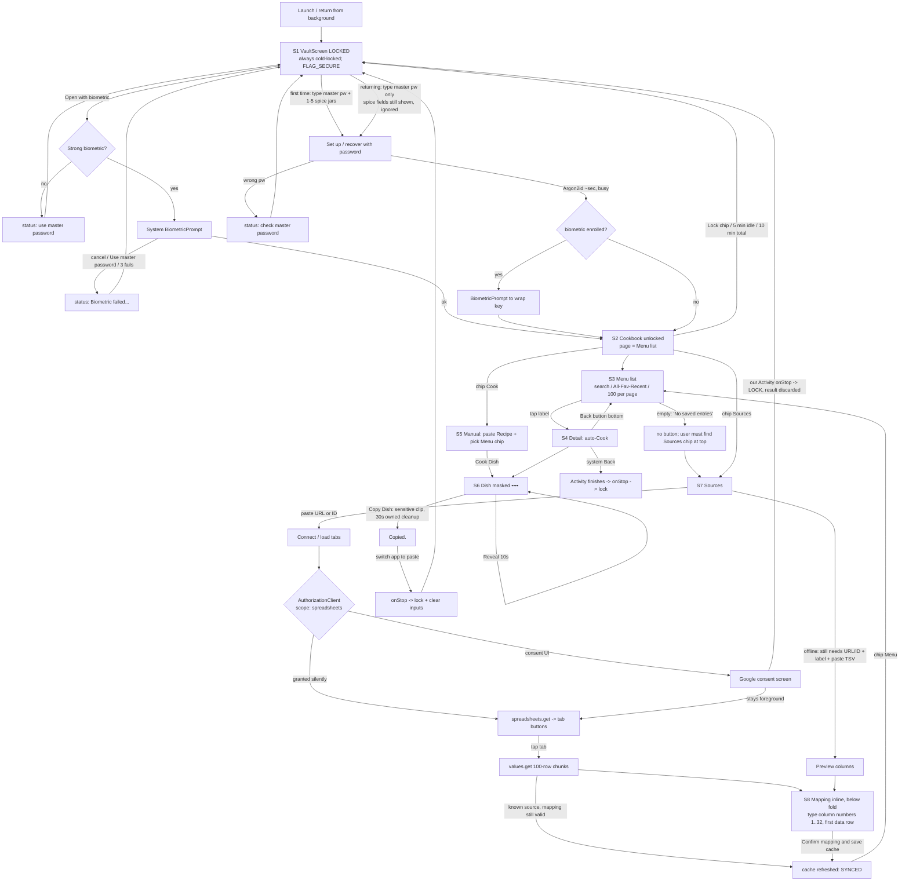

# 01 — Android app: current UX flow audit

Date 2026-11-10. Read-only audit of `app/src/main/kotlin/dev/passchef/mobile/**` + specs
(mobile-cookbook, mobile-keystore, mobile-sheets-client, qr-handoff, cross-platform-design).
Paths below are relative to `app/src/main/kotlin/dev/passchef/mobile/` unless prefixed.

## 1. Screen inventory

No Navigation library, no `Scaffold`, no `BackHandler`, no `LazyColumn`, no icon set. "Screens" = composables
swapped by `if`/`when` on in-memory state.

| # | Screen / composable | file:line | Purpose | State shown |
|---|---|---|---|---|
| S0 | App shell `MainCookbookScreen` | cookbook/MainCookbookScreen.kt:13-31 | Theme, header, locked↔unlocked switch | `vault.unlocked` picks S1 or S2; `vi` lang flag (`remember`, from `Locale`, not persisted) |
| S0h | Header `PassChefHeader` | ui/cookbook-components.kt:25-45 | Logo + Pass/Chef wordmark + EN/VI toggle | toggle label shows *target* lang ("EN"/"VI"); toggle calls `cookbook.edit()` → wipes Dish (MainCookbookScreen.kt:20) |
| S1 | Vault setup/unlock `VaultScreen` | VaultScreen.kt:22-73 | First setup AND unlock AND recovery in one form | title, status banner (`vaultStatus`), master pw, 5 "spice jar (setup only)" fields, "Set up / recover with password" primary, "Open with biometric" secondary, "Lock Cookbook" ghost (shown while locked), timer footnote |
| S1b | System BiometricPrompt | MainActivity.kt:33-59 | Unwrap/wrap master key | EN-only title "Open your Cookbook", subtitle "Authorize this device key operation", negative "Use master password"; 3 fails → cancel |
| S2 | Cookbook shell `CookbookScreen` | cookbook/CookbookScreen.kt:15-48 | Single vertical scroll; page switch | "Cookbook" display title; 3 outlined chips Menu/Cook/Sources (FlowRow :29-33); "Lock" ghost (:34); body = Detail if `selected!=null` else page |
| S3 | Menu list `CookbookList` | cookbook/cookbook-list.kt:14-64 | Browse/search cached recipes | status banner (default "Offline cache; Connect to refresh."), search field, All/Favorites/Recent chips, empty text, "Entries: N · p/P", Prev/Next, ≤100 bordered cards (label button, username, `tab · row`, Favorite button) |
| S4 | Entry detail `CookbookDetail` | cookbook/cookbook-manual-detail.kt:35-54 | Auto-cooks on open, show Dish | label, username, `tab · row`, raw Recipe (mono), url, notes, "verification tag" note, DishPanel, Copy username, Back (bottom) |
| S5 | Manual Cook `ManualCook` | cookbook/cookbook-manual-detail.kt:12-33 | Paste a Recipe, pick Menu context, cook | Recipe field, "Optional saved Menu context" chips (No Menu + one per saved tab), "Legacy Recipe without a tag" helper, Cook Dish, DishPanel |
| S6 | Dish panel `DishPanel` | cookbook/cookbook-dish-panel.kt:12-34 | Masked result + actions | Cooking…/error/legacy warning banners, `••••••••` slab, "Reveal for 10 seconds", "Copy Dish", clipboard status |
| S7 | Sources `SourceScreen` | cookbook/SourceScreen.kt:12-69 | Connect Google Menu, offline paste, list/remove caches | warning banner (not encrypted + limits), shared "Menu URL or ID" field, Google group (consent note, Connect/load tabs, status, spreadsheet title, tab buttons), Offline group (tab label, TSV textarea, Preview columns), inline Mapping (S8), saved-source cards (title·count·datetime, Clear → AlertDialog) |
| S8 | Mapping `MappingScreen` (inline in S7) | cookbook/MappingScreen.kt:11-46 | Confirm column roles | warning banner, First data row (number), 5 numeric column fields (Recipe/Label/Username/URL/Notes), 5 preview rows `n: a | b | c` each with "Optional custom label" field, Confirm mapping and save cache |
| S9 | Remove-source dialog | cookbook/SourceScreen.kt:61-66 | Confirm clearing cache | "Clear local cache only?" / ghost Clear + Cancel |

Controllers (state owners): `VaultController.kt` (status/busy/unlocked, timers), `cookbook/CookbookController.kt`
(dish/revealed/cooking/code/warning/selected/clipboardStatus), `cookbook/CookbookSources.kt`
(snapshots/draft/metadata/status/busy), `cookbook/AndroidSheetsAuthorization.kt` (OAuth).

## 2. Current flow

## 3. Pain points (ranked)

Sev: **P1** blocks/loses users, **P2** major friction, **P3** polish.

| # | Sev | Area | Problem | Evidence | User impact |
|---|---|---|---|---|---|
| 1 | P1 | Connect Menu | Only way to pick a Google Sheet = paste URL/ID into mono text field; no picker, no recent list, no account shown | SourceScreen.kt:23-25; `menuIdFromInput` shared/.../MenuModels.kt:40-44 | Owner's main complaint. On phone, user must open Sheets app, copy link, return (→ app locks, see #3), unlock, paste |
| 2 | P1 | Setup vs unlock | One form for first setup, unlock and recovery; 5 "Spice jar (setup only)" fields always visible for returning users and silently ignored on recover | VaultScreen.kt:37-60; VaultController.kt:82-83 | Returning user sees 6 password fields to unlock; first-time user unsure what a "spice jar" is or how many to fill; no confirm-password at setup despite "losing it loses access" (:39) |
| 3 | P1 | Security friction | Any background (Google consent, copying Sheet URL from another app, pasting Dish in another app) locks + clears inputs; consent result discarded; composition state (URL field, page, tab list) lost → re-unlock, re-navigate to Sources, re-paste, re-Connect | MainActivity.kt:65; AndroidSheetsAuthorization.kt:11,23; SourceScreen.kt:15,27 (copy literally tells user to "Unlock and Connect again") | Google onboarding can need 2+ unlocks and repeated paste; feels broken |
| 4 | P1 | Errors | Invalid URL/ID sets `model.code="INVALID_MENU"` but Sources screen never renders `model.code` (only DishPanel does) → silent failure. Same for offline Preview with bad ID and Connect while not ready | CookbookController.kt:57,63; SourceScreen.kt:31 (renders `sources.status` only); cookbook-dish-panel.kt:16 | Tap Connect, nothing happens |
| 5 | P1 | Navigation | No `BackHandler`: system Back on Detail/Sources/Mapping finishes Activity → onStop → lock. In-app Back only at bottom of Detail | grep: no BackHandler; MainActivity.kt:65; cookbook-manual-detail.kt:52 | Natural Android gesture throws user out and forces re-unlock |
| 6 | P2 | Offline import | Offline paste still requires the Google "Menu URL or ID" field (10–200 `[A-Za-z0-9_-]`) though it "does not connect to Google"; field sits outside both groups | SourceScreen.kt:23,50; CookbookController.kt:57; MenuModels.kt:10 | Offline-only Chef must invent a fake Sheet ID; unexplained disabled button |
| 7 | P2 | Mapping | Columns chosen by typing 1-based numbers into 5 text fields; no A/B/C letters (Sheets uses letters), no header names next to field, no dropdown/chips per column; preview = pipe-joined mono lines; "custom label" inputs only for the 5 preview rows | MappingScreen.kt:22-40 | Error-prone; INVALID_MAPPING generic message (CookbookWords.kt:21) |
| 8 | P2 | Navigation model | Single `verticalScroll` for everything; "tabs" are 3 outlined chips at top that scroll away; Lock ghost between nav and content; Detail overlays page while chips stay "selected"; page state reset on lock | CookbookScreen.kt:18,26-38 | No persistent bottom nav; context lost; Mapping appears below fold with no scroll-to (SourceScreen.kt:52) |
| 9 | P2 | Lock after copy | Copy Dish → switch to target app → app locked on return; every next account needs unlock again (biometric only if user taps button — no auto prompt) | MainActivity.kt:65; VaultScreen.kt:61-63 | Multi-account login sessions = repeated unlocks; biometric is secondary button under password |
| 10 | P2 | Refresh | Saved source card has no Refresh/Reconnect action; refresh requires re-paste URL → Connect → pick tab again. Card shows only tab title (spreadsheet name not stored), count, raw datetime | SourceScreen.kt:53-60; CookbookSources.kt:66-75 | Stale caches; persistent "Offline cache; Connect to refresh." banner on list with no button (cookbook-list.kt:19, CookbookSources.kt:18) |
| 11 | P2 | Info density (list) | Each entry = bordered card with title TextButton, username, `tab · row`, full-width Favorite button (~4 lines, ~170dp); only label button is tappable; non-lazy Column renders up to 100 cards; pager Prev/Next above list | cookbook-list.kt:40-62 | ~3–4 entries per screen; no quick copy username/Dish from row; no URL/domain/initial avatar; perf risk at 100 composables |
| 12 | P2 | Empty states | Empty list = muted sentence "Cook manually or add a source." with no CTA; Sources has no guided first-run | cookbook-list.kt:36-37 | New user lands on empty list after setup, must discover "Sources" chip |
| 13 | P2 | Jargon | "spice jar", "Menu context", "Legacy Recipe without a tag", "Verification tag included (checked only when cooking)", "Local metadata … not encrypted", "tab-separated", "First data row", "Authorize this device key operation", status "Biometric round trip succeeded" | VaultScreen.kt:39,48; cookbook-manual-detail.kt:20,28,47; SourceScreen.kt:21,42; MappingScreen.kt:22; MainActivity.kt:55; VaultController.kt:138 | Engineering wording leaks into UI; cooking metaphor partially applied, inconsistently |
| 14 | P2 | Bilingual | VI mixes EN ("Copy Dish", "Recipe", "cache", "tab"); BiometricPrompt EN-only; language not persisted and toggling wipes current Dish | cookbook-dish-panel.kt:29; MappingScreen.kt:28; MainActivity.kt:54-56; MainCookbookScreen.kt:14,20 | VI users get half-translated, unexpected Dish loss |
| 15 | P2 | Feedback lost | Success/degraded unlock messages ("strong biometric unavailable", "biometrics are locked") set on `status` but S1 is replaced by S2 on unlock → never seen | VaultController.kt:102,112,155-156; MainCookbookScreen.kt:22-25 | User never learns biometric not set up |
| 16 | P2 | Spices lifecycle | No way to view count/add/change Spices or change master password after setup ("setup only") | VaultScreen.kt:48 | "Add Spices" exists only at first setup; MISSING_SPICE error (CookbookWords.kt:9) has no fix path |
| 17 | P3 | Detail hierarchy | Order: label/username/raw Recipe/url/notes → Dish → Copy username → Back. Username copy after Dish (login order is username first); URL not tappable; Recipe shown raw (low value); no clipboard countdown ("clears in 30s") | cookbook-manual-detail.kt:39-52; cookbook-dish-panel.kt:27-32 | Extra scroll; Copy below fold when notes long |
| 18 | P3 | Visual hierarchy | Everything = same 1dp-bordered square surface (`shapes.medium=0dp`), outlined buttons, flat colored text banners; no icons (no icons dependency), no elevation, no motion; 3 display titles (wordmark, "PassChef — private Cookbook", "Cookbook") | ui/passchef-theme.kt:14-20; ui/cookbook-components.kt:49-101; VaultScreen.kt:34; CookbookScreen.kt:28 | "Too plain"; primary action not obvious; status banners look like content |
| 19 | P3 | One-handed | Nav chips, Lock, search, lang toggle all top; primary Cook/Copy mid-scroll; Back bottom; no bottom bar/FAB | CookbookScreen.kt:29-34; cookbook-list.kt:21 | Thumb reach poor on 6.5"+ phones |
| 20 | P3 | Locked screen | "Lock Cookbook" button shown while already locked; long timer footnote | VaultScreen.kt:66-70 | Noise |
| 21 | P3 | Typing-invalidates | Every keystroke in Sources fields calls `changed()` → invalidates auth + `sources.invalidate()` → clears loaded tab list/draft | SourceScreen.kt:19,23,44,46 | Editing offline label after loading Google tabs wipes the tabs silently |
| 22 | P3 | Search | Only label/username; not URL/notes; no source filter when multiple Menus merged | shared/.../MenuModels.kt:45-47; cookbook-list.kt:28-34 | Hard to find by site |
| 23 | P3 | Manual Cook | Menu context = chips of *tab titles* (up to 20, ambiguous if same tab name in two sheets); wrong choice → RECIPE_MISMATCH | cookbook-manual-detail.kt:21-27 | Confusing for tagged recipes |
| 24 | P3 | Destructive styling | Remove-source "Clear" is ghost text, same as Cancel | SourceScreen.kt:64-66 | Low affordance |

## 4. Hard constraints a redesign must keep

Security/session
- `FLAG_SECURE` on window (MainActivity.kt:25); no screenshots/Recents preview.
- Cold start + Activity recreation start locked; no session restore (MainActivity.kt:14). `onStop` → `clearInputs()` + `controller.lock()` (MainActivity.kt:65). Lock invalidates Dish, selection, OAuth ownership, in-flight source work (CookbookController.kt:25).
- Sensitive inputs use `remember`, never `rememberSaveable`; cleared on submit/background (VaultScreen.kt:25-29). Password/spice bytes zeroed after use.
- Session: 5 min idle / 10 min absolute, monotonic, checked every 1s; touches extend idle only (VaultController.kt:52-72, MainActivity.kt:67-69). New Cook does not extend absolute window.
- Dish masked by default; Reveal auto-hides after 10s (CookbookController.kt:39-44); any edit/navigation/language toggle invalidates Dish (`edit()` :24).
- Crypto: Argon2id v19 t3 64MiB p4, AES-256-GCM spice cache; master key wrapped by Class-3 (BIOMETRIC_STRONG) Keystore key with CryptoObject per op; StrongBox preferred; password fallback for invalidated key/lockout/no enrollment; no device-PIN substitute (mobile-keystore.md). 3 failed scans cancel prompt (MainActivity.kt:51). Biometric/Google UIs stay native; never imitate account login UI (cross-platform-design.md).
- Spices: 1–5 jars, each 1–4096 UTF-8 bytes; master pw ≤4096 bytes (UI caps 1024 chars, VaultScreen.kt:41,47). Spices never displayed after unlock.
- UI must NOT infer first setup from status strings or read repository state in composition (cross-platform-design.md "security invariants") → splitting setup vs unlock requires a controller-exposed flag.
- Clipboard (cookbook/OwnedClipboard.kt): copy only while foreground; Dish clip flagged `android.content.extra.IS_SENSITIVE`, unique label `PassChef Dish <uuid>`, SHA-256 digest; owned cleanup after 30s only if still ours (API<28 writes empty clip); username copy not auto-cleared and forgets Dish ownership; process-owned, survives Activity recreation; report success only after write.
- Backup: `allowBackup=false`, `fullBackupContent=false`, `data_extraction_rules.xml` excludes all domains for cloud-backup and device-transfer; data in `noBackupFilesDir` (`cookbook-v1.json`, `menus/*.menu.json`).
- Menu snapshots are app-private but **not encrypted** (Recipe, label, username, URL, notes, favorites, recent). No Dish/Spice/key/token in snapshots. UI copy must not imply encryption.
- Permissions: INTERNET, USE_BIOMETRIC, USE_FINGERPRINT only. minSdk 26, targetSdk 34.

Limits
- 20 sources (cache files) — enforced shared/src/jvmAndroidMain/.../MenuSnapshotStore.kt:19; 21st → CACHE_FAILED.
- 1000 rows (`MAX_ROWS`), 32 columns (`MAX_COLUMNS`), 4096 chars/cell (`MAX_CELL`) — shared/.../MenuModels.kt:6-8.
- Offline paste ≤120,000 chars (CookbookSources.kt:82); URL/ID input ≤300; tab title 1–200; Recipe input ≤4096; Menu ID regex `[A-Za-z0-9_-]{10,200}`; recent ≤20 per source; list page 100.
- Mapping: Recipe column required, roles unique, suggestions (≥3 examples, ≥0.6 confidence) proposed never auto-confirmed; header/drift change → reconfirm (mobile-cookbook.md "Private offline Menu").

OAuth / Google
- Exact scope: `https://www.googleapis.com/auth/spreadsheets` (read+write) — shared/src/commonMain/.../AuthorizationGrantPolicy.kt:4. Only scope requested. Business rule R1/D3: read+write chosen to avoid later re-grant; app currently only reads (metadata + values). No Drive scope, no sign-in/ID-token scope.
- Mechanism: Google Identity Services `Identity.getAuthorizationClient(activity).authorize(AuthorizationRequest.setRequestedScopes([SHEETS]))`; if `hasResolution()` launch `pendingIntent` via `StartIntentSenderForResult`, then `getAuthorizationResultFromIntent` (AndroidSheetsAuthorization.kt:32-50). Token accepted only if non-blank, ≤16384 chars and `grantedScopes` contains the scope.
- Access token RAM-only; ownership ticket discards callbacks after lock/source change (AndroidSheetsAuthorization.kt:23,38,41). 401 → token evicted via `clearToken` before next explicit Connect (rejected-token-cache-gate.kt); never auto-reauthorize. 403 → ACCESS_DENIED. Failed refresh preserves last good cache.
- Reads: `spreadsheets.get` metadata, then `values.get` in 100-row quoted A1 chunks bounded to declared grid (SheetsMenus.kt, SheetsReadRanges.kt). Literal values preserved.
- Consequence: a native sheet *picker* (Drive Picker / Drive files list) needs an additional scope (e.g. `drive.file` or `drive.metadata.readonly`) → new consent text, OAuth verification impact, extension parity; not available with current scope.

Design system / process
- Precision tokens (ui/passchef-palette.kt), Fraunces only for static NFC titles, Geist for dynamic labels, Geist Mono for Recipe/Dish; ≥48dp targets; phone gutters 20/24dp; 4dp control radius (cross-platform-design.md).
- Spec scope fence: Android nav = Menu / Cook / Sources + separate Lock; do not add QR scanner/Autofill/Drive/profile/account authoring/light mode without owner decision.
- Keep EN/VI strings and existing `testTag`s used by androidTest proofs: `source-id`, `source-table`, `column-<ROLE>`, `confirm-columns`, `menu-search`, `manual-recipe`, `manual-cook`, `dish-display`, `dish-reveal`, `dish-copy`, `cook-error`. Golden tests immutable (AGENTS.md).

## Unresolved questions
1. Is adding a Drive scope (`drive.file` + Google Picker, or `drive.metadata.readonly` list) acceptable to owner, given R1/D3 "settled" scope and OAuth verification cost? Without it, sheet picking stays paste-based (could be improved via Android share-intent from Sheets app / clipboard detect / recent-URL list).
2. Should background-lock tolerate the Google consent hop (e.g. short grace while our own authorization intent is pending), or is strict lock-on-onStop non-negotiable? Same for "copy then switch app" grace.
3. May the controller expose `hasRecord` (setup vs unlock) to UI? Spec forbids composition reading repository state; needs explicit decision.
4. Should Spice add/edit and master-password change be in redesign scope (currently impossible post-setup)?
5. Offline TSV: allow without any Sheet ID (generate local origin id)? Changes `MenuOrigin` key semantics/cache filenames.
6. Spec mentions an "original both-scope" approval in Google36/401 evidence (mobile-cookbook.md) while code requests one scope — clarify which second scope was meant.
7. Is light theme / dynamic color explicitly out of scope ("do not promote light mode") for the redesign too?
