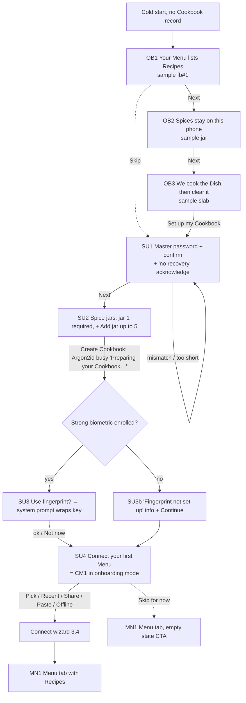
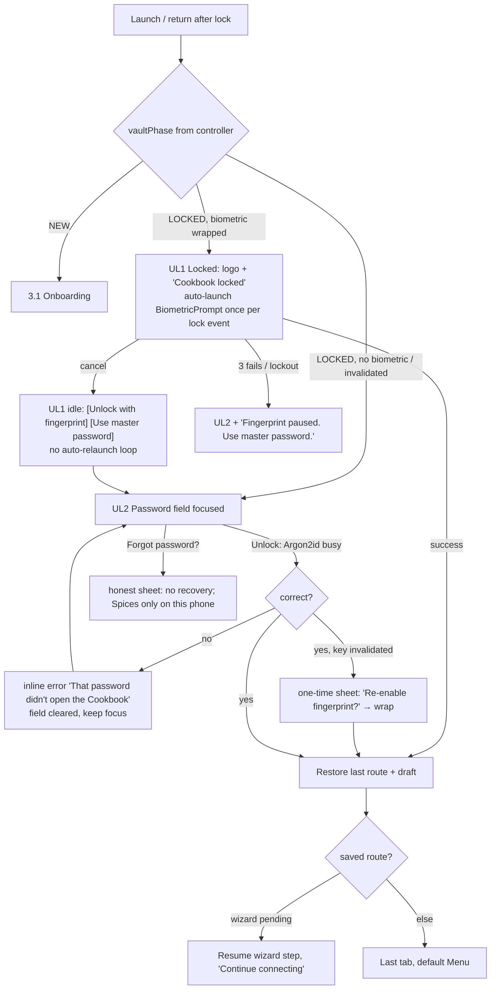
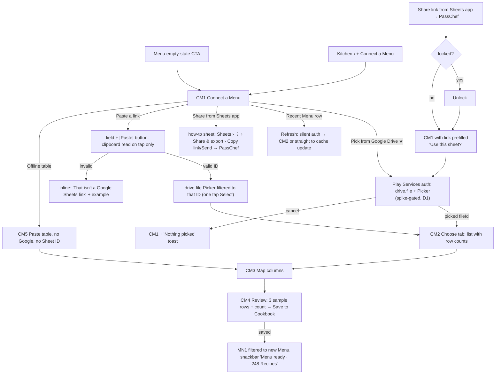
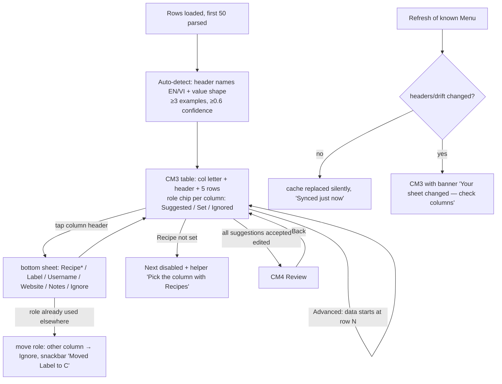
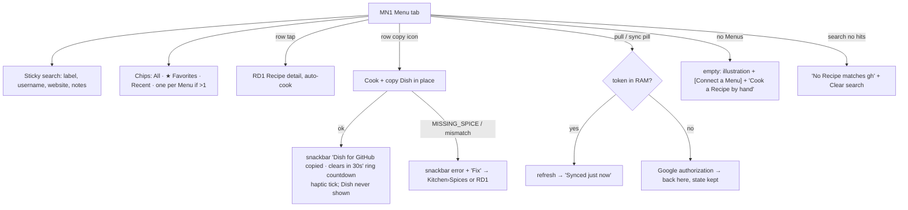
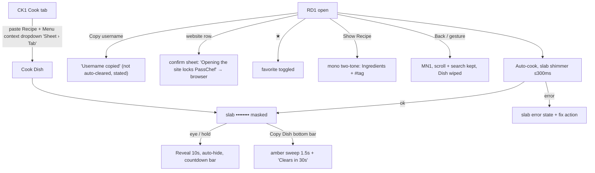
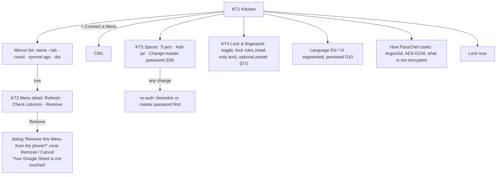
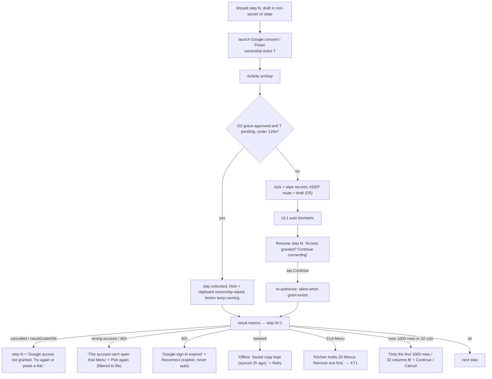
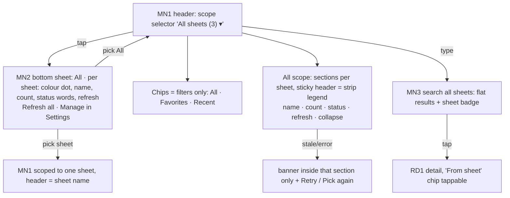

# PassChef Android — UX flow redesign spec

Date 2026-11-10. Owner: lead UX. Status: **v2 — owner feedback applied; D13 decided, other decisions pending** (see §9).
Inputs: [00 insight](reports/00-product-insight-and-value.md) · [05 terms](reports/05-plain-language-terminology.md) · [06 palette](reports/06-palette-study.md) · [01 audit](reports/01-current-flow-audit.md) · [02 picker](reports/02-sheet-picker-research.md) ·
[03 patterns](reports/03-password-manager-ux-patterns.md) · [04 design language](reports/04-extension-design-language.md) ·
[wireframes](visuals/android-ux-wireframes.html) · [plan](plan.md).
Baseline: `docs/specs/cross-platform-design.md` tokens (dark = Precision Ink+Amber) + palette D light (needs spec edit, D13), `docs/specs/mobile-cookbook.md` security.
Design only. No Kotlin changed. Paths relative to `app/src/main/kotlin/dev/passchef/mobile/`.

### v2 amendments (supersede v1 wording below where they conflict)
- **Audience:** general users, mainly office workers (not only technical; no senior framing). Family hand-over = light mention only.
- **Terms (report 05, D14):** UI uses plain words. Cooking words = brand flavor only (tagline "Don't keep the password. Keep the recipe." / "Đừng giữ mật khẩu. Giữ công thức.", logo, store/landing). Internal code/testTag names unchanged.

| v1 (internal) | UI EN / VI |
|---|---|
| Menu (sheet tab) | Sheet / Bảng tính |
| Recipe `r4nd0m#1` | Written code / Mã đã ghi |
| Ingredients | Random part / Phần ngẫu nhiên |
| Spice, jar | Secret part #n / Phần bí mật số n |
| Cook (button) | Get password / Lấy mật khẩu |
| Dish | Password / Mật khẩu |
| Cookbook | Private vault / Két riêng |
| Tabs Menu · Cook · Kitchen | Passwords / Mật khẩu · Enter code / Nhập mã · Settings / Cài đặt |
| How PassChef cooks | How it works / Cách hoạt động |

- **Written code always visible** (list row, detail, mapping) in mono, **always with a plain gloss**, e.g. `x9Lk2m#2` "= add secret part 2 in front". Never raw syntax alone; never hidden. App = faster than computing by hand, equally transparent. Other markers (`$ @ % ^`) explained in How it works.
- **Wordmark:** "PassChef", no dot; "Chef" in accent-ink. Applies everywhere (§4 ASCII `Pass●Chef` = read as `PassChef`).
- **Palette D (DECIDED, D13):** dark (= Precision Ink+Amber) and Linen light equal first-class; app follows system + Settings › Theme (System / Dark / Light). Calm via restraint: amber fill only for ONE main action per screen (+ logo); chips/toggles/nav/role states neutral (text colour); faint vignette; no copy-sweep glow. Light: accent-ink #8a5610 for text links + 1px #8a5610 edge on amber fills; status success #3c7535 / warning #8a6100 / error #b4372d. Tokens in report 06 + wireframes `:root`/`[data-theme]`.
- **First run:** OB1–OB3 replaced by E1–E4 (§4; v3: E1 interactive tear, E2 stranger view). Removed overclaim "others seeing the sheet is fine".
- **Secret parts:** 1–5, user picks how many (D15).

Rejected from 03: cream/terracotta palette (P18) — conflicts with Precision; P2 "defer master" — no Dish without a Spice.

## 1. Design principles

1. **Lock secrets, not the Chef's place.** Lock wipes Dish/Spice/token; it must NOT wipe where the user was (tab, wizard step, picked Menu, mapping draft). These are non-secret.
2. **Biometric first, password as authority.** Returning user = one touch. Master password always available, never hidden behind > 1 tap.
3. **Pick, don't paste.** Choosing a Menu is a tap on a list (Drive Picker / recent Menus / share-in). Paste link is the escape hatch, not the front door.
4. **One screen, one job.** Setup ≠ unlock ≠ recover. Connect = linear wizard with step dots. No 6-field forms.
5. **Thumb zone for the money action.** Cook / Copy / Next live in a sticky bottom bar; nav at bottom; top bar = back + context only.
6. **Every state speaks.** Empty, loading, error, offline, locked each have wording + next action. No silent `code` (audit #4).
7. **Calm via restraint.** One amber main action per screen; everything else neutral. Warmth via Fraunces italic + line illustrations in explainer/empty states only. Plain words in UI, cooking only as brand tagline; crypto words + honest caveats live in "How it works".
8. **Transparent, not a black box.** Written code always visible with a plain gloss; the user could compute the password by hand.

## 2. Information architecture + navigation

**Recommendation: single-Activity, 3-tab bottom navigation + pushed screens, lock as gate (not tab).**

```
Gate (outside nav): Onboarding+Setup  |  Unlock
└─ App shell (unlocked)
   ├─ [Menu]    Thực đơn  — home list, search, chips ─► Recipe detail (push)
   ├─ [Cook]    Nấu       — manual Recipe → Dish
   └─ [Kitchen] Bếp       — Menus(sources) ─► Connect wizard (push, 4 steps) / Menu detail
                            Spices · Lock & fingerprint · Language · How PassChef cooks
   Header (all tabs): wordmark · status dot · Lock-now icon
```

Why bottom nav (vs current single scroll / vs single stack):
- 3 stable destinations = M3 nav-bar sweet spot (03-P16); thumb reach (audit #19); persistent context (audit #8).
- Keeps prior contract's 3 areas (Menu / Cook / Sources) — "Sources" renamed **Kitchen** and widened to host settings that today have no home (Spices #16, language #14, lock policy). Connect is a one-time wizard, not a daily tab (03-P17).
- Single stack rejected: Cook (manual) would be buried; Menu switching needs >1 level.
- Implementation hint: tiny in-house route stack + `BackHandler` (activity-compose already present) — no navigation-compose dep needed (KISS). Each tab keeps its own back stack; reselect tab = pop to root.
- System Back: pushed screen → pop; wizard step → previous step; tab root (not Menu) → Menu; Menu root → finish (lock). Fixes #5.

## 3. Flows

### 3.1 First run: onboarding + setup


### 3.2 Unlock (biometric-first)


### 3.3 Connect Menu: chooser (picker primary, fallbacks)

**D1 decided (Go, `drive.file` only):** `spreadsheets` scope removed. Paste URL and Share-in no longer grant access by themselves: they parse the ID, then open the Picker filtered to that file (`PICKER_FILE_IDS`) so the user confirms with one tap. Recent / refresh = stored ID + silent `authorize` (~100ms, no UI). Lost access (404 or 403) → "Choose this sheet again" → filtered Picker. Picker cancel (ApiException 16) → calm "Not connected. Try again". Picker is Google's full-screen UI (not covered by our FLAG_SECURE; shows thumbnails) → CM1 says "Google will show your Drive".

### 3.4 Column mapping

Suggestions are proposed, never auto-confirmed (spec rule): user must tap "Looks right" or edit before Next.

### 3.5 Home: list, search, copy


### 3.6 Recipe detail / Cook


### 3.7 Kitchen (settings)


### 3.8 Errors + recovery (incl. consent round-trip)

Other recovery: MISSING_SPICE → "This Recipe needs Spice jar 3" + Kitchen›Spices; RECIPE_MISMATCH → "This Recipe belongs to another Menu" + choose Menu; corrupt cache → "This Menu's saved copy is damaged. Refresh or remove." Never auto-retry auth; never drop last good cache.

## 4. Screen-by-screen spec

Conventions: phone 360dp, gutters 20dp, targets ≥48dp, bottom bar 64dp + nav 72dp. `[ ]` button, `( )` chip, `▸` primary arrow, `●` status dot, `~~` vignette. testTags: **kept** = existing (androidTest proofs), *new* = proposed.

### E1–E4 First-run explainer (v3, owner 2026-11-10; replaces OB1–OB3)
Skip on every screen (skips explainer only, not setup); re-open from Settings › How it works. Fake, labelled data. One running example on all screens: full password `rand0mBasic*` = code `rand0m` + secret part 1 `Basic*` at the end → written code `rand0m$1` (`$` = add at end, per extension `generate_password.js`). Options explored: `visuals/e1-onboarding-options.html` (A–F).
```
┌──────────────────────────────┐
│ PassChef               Skip  │
│ [Normal way][Tear off secret]│ toggle; auto-tears once at 1.2s
│ ┌rand0m$1┐      ╱Basic*╱     │ piece flies off, rotated
│ └stays on paper┘ kept apart  │
│ ┌───────────┬┄┬────────────┐ │
│ │Full passwd│✂│Written code│ │ code column + cut line fade in
│ │rand0m[Basic*] │ rand0m$1 │ │ ×3 rows, same secret part
│ │never written  │ on paper │ │
│ └───────────────┴──────────┘ │
│ 🔒 This is only a code. …     │ live region; red in Normal state
│ Tear the secret part off.    │
│ *What's left is useless code.*│
│ ↻ Play again                 │
│          ● ○ ○ ○             │
│ [        Next  ▸           ] │ never blocked
└──────────────────────────────┘
```
- **E1 interactive tear** (= option F, D+E). Rule: reader must never take the written code for the full password; two named things only: **Full password / Mật khẩu đầy đủ** and **Written code / Mã đã ghi**.
  - Normal state: paper `rand0mBasic*` whole; table shows only Full password column (Facebook/Gmail/Bank, all `…Basic*`), footer "written on paper" (red); verdict red "This is the **full password**. Anyone who reads it can log in." / "Đây là **mật khẩu đầy đủ**. Ai đọc cũng đăng nhập được."
  - Torn state (auto once at 1.2s, or toggle): `Basic*` piece flies off ("kept apart / giữ riêng"), `$1` appears ("stays on paper · code"); secret part highlighted in table, cut line ✂ + Written code column fade in; footer "never written down | on paper"; verdict green "This is only a **code**. Anyone who reads it still can't log in." / "Đây chỉ là **mã**. Ai đọc cũng không đăng nhập được."
  - Title "Tear the secret part off. *What's left is useless code.*" / "Xé phần bí mật ra. *Phần còn lại là mã vô dụng.*" + text button "Play again / Xem lại".
  - Motion: ~700ms translate/rotate/clip (Compose `animate*AsState` / `updateTransition`, no new lib). Reduced motion (system animator scale 0) = instant swap. Verdict = `liveRegion` polite. Tags `onboarding-tear-toggle`, `onboarding-tear-replay`.
- **E2 stranger's view** (= option B). Mock sheet "Your sheet · example": Facebook `rand0m$1`, Gmail `x9Lk2m$1`, Bank `p3Zn7w$1`. Card "A stranger tries Facebook": field `rand0m$1` → "Wrong password. That's only a code." / "Sai mật khẩu. Đó chỉ là mã." Title "Sheet leaked? Strangers *see only codes*." / "Lộ bảng tính? Người lạ *chỉ thấy mã*." Body: full password = code + secret part only you know; never in the sheet.
- **E3 do it by hand** (was E2): Written code `rand0m$1` + gloss "$1 = add secret part 1 at the end" + Secret part 1 `Basic*` = Password `rand0mBasic*`. Title "No app? *Do it by hand.*" / "Không có app? *Tự tính tay* vẫn được." Box: "Your sheet + your secret parts are enough. Forgot the app password? You don't lose your accounts. The app is just faster."
- **E4 secret parts** (was E3): "Pick *1 to 5* secret parts. Keep a copy apart." / "Chọn *1–5* phần bí mật. Cất một bản riêng." Body: away from the sheet, e.g. sealed envelope for family; app encrypts them in a private vault on this phone. CTA [Set up my vault ▸] / [Lập két riêng ▸] + Not now / Để sau.
- Caveats (sheet shows account names; weak secret part; site leak + sheet leak) go to SU2 + How it works, calm tone (report 05 §4). Tags *`onboarding-next`*, *`onboarding-skip`*, *`onboarding-later`*.

### SU1 Master password
```
│ ←            STEP 1 OF 3     │  mono caption
│ Create your master password  │
│ It opens your Cookbook. We   │
│ can't reset it.              │
│ ┌ Master password ───────👁┐ │
│ ┌ Type it again ─────────👁┐ │
│ strength: ▮▮▮▯  long is good │
│ ☐ I understand: lose it =    │
│   lose every Dish.           │  honey tint block
│ [        Next  ▸           ] │  disabled until match+ack
```
Errors: "Passwords don't match" / "Mật khẩu chưa khớp"; >1024 chars blocked. `remember` only, cleared on background. Tags *`setup-master`*, *`setup-master-confirm`*, *`setup-ack`*.

### SU2 Spice jars
```
│ ←            STEP 2 OF 3     │
│ Add your *Spices*            │
│ Secret phrases mixed into    │
│ every Dish. 1 is enough;     │
│ up to 5.                     │
│ JAR 1  ┌───────────────👁┐   │
│ JAR 2  ┌───────────────👁┐ ✕ │
│ [ + Add another jar ]  2/5   │
│ [   Create Cookbook  ▸     ] │
```
Busy: button → "Preparing your Cookbook…" + inline progress (Argon2id ~1s); inputs disabled. Error: empty jar → "Jar 2 is empty — fill or remove it". VI "Thêm *Gia vị* của bạn", "Tạo Sổ bếp". Tags *`setup-spice-<n>`*, *`setup-add-spice`*, *`setup-create`*.

### SU3 Fingerprint
Copy "Open with your fingerprint next time?" / "Lần sau mở bằng vân tay?" [Use fingerprint ▸] (system prompt) · [Not now]. If not enrolled: info "Fingerprint isn't set up on this phone. You'll use your master password." (fixes #15: message shown before leaving gate). Tag *`setup-biometric`*.

### SU4 / CM1 Connect a Menu (chooser)
```
│ ←  (or Skip for now)         │
│ Connect a *Menu*             │
│ Pick the Google Sheet that   │
│ holds your Recipes.          │
│ ┌──────────────────────────┐ │
│ │ ⬡ Pick from Google Drive │ │  amber outline card, primary
│ │ PassChef sees only the   │ │
│ │ sheet you pick.     ▸    │ │
│ └──────────────────────────┘ │
│ RECENT MENUS                 │
│ ▤ Work logins › Sheet1  ↻    │  one tap refresh
│ ▤ Family › Recipes      ↻    │
│ OTHER WAYS                   │
│ ⇪ Share from Sheets app   ›  │
│ 🔗 Paste a link           ›  │
│ ▦ Offline table (no Google) ›│
│ Menu copies on this phone    │
│ are not encrypted. Spices    │  muted helper, honest
│ are.                         │
```
Paste row expands inline: field (mono, tag **kept `source-id`**) + [Paste] (reads clipboard on tap) + [Continue ▸]. Loading: card shows spinner "Opening Google…". Error inline under the row that failed (fix #4). Empty Recent: section hidden. VI: "Kết nối *Thực đơn*", "Chọn từ Google Drive", "Chia sẻ từ ứng dụng Trang tính", "Dán đường liên kết", "Bảng ngoại tuyến (không cần Google)". Tags *`connect-pick-drive`*, *`connect-recent-<menuId>`*, *`connect-share-help`*, *`connect-paste`*, *`connect-offline`*.

### CM2 Choose tab
```
│ ←        ● ● ○ ○             │
│ Work logins                  │  Geist 600 (dynamic)
│ Which tab holds Recipes?     │
│ ○ Sheet1          248 rows   │
│ ● Logins          97 rows    │
│ ○ Archive         12 rows    │
│ [        Next  ▸           ] │
```
Loading: 3 skeleton rows. Single tab → auto-select, still shown (user confirms). Tags *`tab-<index>`*.

### CM3 Map columns
```
│ ←        ● ● ● ○             │
│ Which column is which?       │
│ We guessed — check them.     │
│ ⇆ ┌────┬─────┬──────┬────┐   │ horizontal scroll
│   │ A  │ B   │ C    │ D  │   │ mono letters
│   │Site│Login│Recipe│Note│   │ header names
│   │(Lbl)(User)(Recipe★)(—)│   │ role chips; ★ required
│   ├────┼─────┼──────┼────┤   │
│   │GitH│vt@..│gh#2  │ 2FA│   │ 5 preview rows, mono
│   │Bank│van..│bk#1  │    │   │
│ ⬤ First row is headings      │ switch
│ ▸ Advanced: data starts row 2│
│ [ Looks right — Review ▸   ] │
```
Chip states: *Suggested* (dashed amber) → *Set* (amber fill) → *Ignored* (ink). Tap header → role sheet. Error: no Recipe → disabled + helper. Bad mapping → "Recipe column C has empty cells in 40% of rows — pick another?" (replaces generic INVALID_MAPPING). Tags: role selector per role keeps **`column-<ROLE>`** (accepts number or letter), Next keeps **`confirm-columns`**. VI "Cột nào là gì?", "Hàng đầu là tiêu đề".

### CM4 Review
3 sample rows rendered exactly as MN1 rows + "248 Recipes will be saved on this phone (not encrypted)." [Save to Cookbook ▸]. Success → MN1 + snackbar. Tag *`connect-save`*.

### CM5 Offline table
Label field ("Menu name") + mono textarea (tag **kept `source-table`**) + [Paste] + helper "Copy cells from any spreadsheet, paste here." No Sheet ID (D9). → CM3.

### UL1 / UL2 Unlock
```
│ Pass●Chef               EN ⇄ │  dot = ink (locked)
│ ~~                        ~~ │  vignette neutral
│        [chef-keyhole]        │
│ Your Cookbook is *locked*    │
│                              │
│ [ ◉ Unlock with fingerprint ▸]│ amber
│ [    Use master password    ]│ secondary
│ Locks after 5 min idle,      │
│ 10 min max, or when you      │  one short line
│ leave the app.               │
```
UL2 expands password field (autofocus, IME Go = Unlock) + "Forgot password?". Busy: "Opening…". Error inline coral. No "Lock" button on locked screen (#20). Tags *`unlock-biometric`*, *`unlock-password`*, *`unlock-submit`*. VI "Sổ bếp đang *khóa*", "Mở bằng vân tay", "Dùng mật khẩu chính". BiometricPrompt title localized: "Open your Cookbook" / "Mở Sổ bếp".

### MN1–MN3 Passwords home with many sheets (v3, supersedes MN1 below)
Owner: v2 list broke with many sheets. Fixes: (1) chips mixed sheets + filters; (2) one global "updated 2h ago" hid stale/errored sheet; (3) colour strip unexplained; (4) same name in 2 sheets indistinguishable; (5) sheets may use different secret-part sets → "#2" ambiguous.

- **Scope selector** (header left, replaces wordmark on this tab): "All sheets (3) ▾" / "Tất cả bảng tính (3) ▾". Last scope remembered (non-secret, D5). Single sheet → selector shows sheet name, no ▾ when only 1 sheet.
- **MN2 bottom sheet**: "Show passwords from" / "Hiện mật khẩu từ"; rows: radio, colour dot, "Work › Logins", "52 · updated 2h ago" / "12 · saved copy, 3 days old" (warning) / "45 · no access — pick again" (error); per-row refresh; footer "Refresh all", "Manage in Settings", "Your choice is remembered next time."
- **Chips** = filters only (All / Favorites / Recent). Sheet scoping never appears as a chip.
- **Sections** (All scope): sticky header with 4px strip = the sheet colour (this is the legend for row strips), name, count, status dot + words, refresh, collapse caret. Status banner only inside its section: "Couldn't refresh this sheet. Passwords still work from the saved copy. Retry" / "Chưa làm mới được bảng này. Mật khẩu vẫn lấy từ bản lưu. Thử lại". Collapse state remembered.
- **MN3 search** spans all sheets regardless of collapse (in single-sheet scope: searches that sheet + "Search all sheets" link). Results flat, caption "3 results · 2 sheets", each row has sheet badge (colour edge + name); duplicates differ by badge + username.
- **Secret-part sets (D17)**: hidden while one set exists. With ≥2, each sheet bound to a set (Settings › Sheets › sheet › "Secret parts set"); gloss = "#1 = add secret part 1 in front · Family set" / "· bộ Gia đình". Search gloss explains per-sheet set once.
- **RD1**: "From sheet" chip (sheet colour edge) tappable → that sheet scope.
- Tags *new*: `scope-selector`, `scope-option-<id|all>`, `sheet-section-<id>`, `sheet-refresh-<id>`, `sheet-badge-<id>`, `detail-sheet-chip`; kept `menu-search`.

### MN1 Menu (home)
```
│ Pass●Chef               🔒   │ dot moss = unlocked
│ ┌🔍 Search Recipes ──────── ✕┐│ sticky, tag kept `menu-search`
│ (All)(★ Fav)(Recent)(Work)(…)│ chips 3dp, scroll
│ WORK · SYNCED 2H AGO   ↻     │ mono caption pill
│ RECENT                       │
│ ▌G GitHub          [⧉]       │ 3px source strip, initial tile
│ ▌  van@… · github.com        │
│ ▌B Bank            [⧉]       │
│ ALL RECIPES · 248            │
│ ▌A Amazon          [⧉]       │ 64dp rows, LazyColumn
├──────────────────────────────┤
│  ▤ Menu    ◔ Cook   ⌂ Kitchen│ amber underline active
```
Row: tap → RD1; [⧉] = cook+copy Dish (D12). Empty (no Menus): line-art plate + "Your Menu is empty" + [Connect a Menu ▸] + text btn "Cook a Recipe by hand" (#12). Loading: skeleton rows. Offline/stale: caption honey "SAVED COPY · 3 DAYS OLD ↻". Tags *`menu-row-<entryId>`*, *`menu-row-copy-<entryId>`*, *`menu-chip-<id>`*, *`nav-menu`*, *`nav-cook`*, *`nav-kitchen`*, *`lock-now`*. VI "Tìm công thức", "Yêu thích", "Gần đây", "Thực đơn trống".

### RD1 Recipe detail
```
│ ←  GitHub              ☆  ⋮  │
│ WORK › LOGINS · ROW 12       │ mono caption
│ USERNAME                     │
│ van@example.com        [⧉]   │
│ DISH                         │
│ ┌──────────────────────────┐ │ slab, tag kept `dish-display`
│ │ ••••••••••••       👁    │ │ eye tag kept `dish-reveal`
│ └──────────────────────────┘ │
│ Clears from clipboard in 30s │ after copy, ring
│ WEBSITE  github.com      ↗   │
│ NOTES    2FA on Authy        │
│ ▸ Show Recipe                │ → gh#2 two-tone mono
├──────────────────────────────┤
│ [Copy username] [Copy Dish ▸]│ sticky; tag kept `dish-copy`
```
States: cooking (slab shimmer "Cooking…"/"Đang nấu…"), error (slab coral border + message, tag kept `cook-error`, + fix action), revealed (Dish mono 22sp, 10s bar). Dish wiped on back. Username copy note "not cleared automatically" once.

### CK1 Cook (manual)
Recipe field mono (tag kept `manual-recipe`) + [Paste]; "Which Menu is it from?" dropdown "None (untagged) / Work › Logins / Family › Recipes" (fixes #23, ambiguous tab names); [Cook Dish ▸] sticky (tag kept `manual-cook`); slab below. Helper only when tag detected: "This Recipe has a tag (#…). Choose its Menu." VI "Nấu tay", "Thuộc thực đơn nào?".

### KT1 Kitchen
```
│ Pass●Chef               🔒   │
│ Kitchen                      │ Fraunces 28
│ MENUS                        │
│ ▌Work › Logins  97 · 2h ●  › │
│ ▌Family › Recipes 12 · 3d ●› │
│ [ + Connect a Menu ]         │
│ SPICES                       │
│ 3 jars in your Cookbook    › │
│ SECURITY                     │
│ Fingerprint unlock     [●━] │
│ Auto-lock   5 min idle · 10 max│
│ LANGUAGE   (EN)( VI )        │
│ How PassChef cooks         › │
│ [ Lock now ]                 │
```
KT2 Menu detail: Refresh / Check columns / Remove (coral, dialog). KT3 Spices: count only (never values), Add jar, Change master password — re-auth first (D8). Tags *`kitchen-menu-<id>`*, *`kitchen-refresh-<id>`*, *`kitchen-remove-<id>`*, *`kitchen-spices`*, *`kitchen-lang-vi`*. VI "Bếp", "Khóa ngay", "Cách PassChef nấu".

## 5. Pain point → fix

| # | Pain | Fix (screen) |
|---|---|---|
| 1 | Paste URL only | CM1 chooser: Drive Picker ★, Recent, Share-in, Paste w/ button, Offline (D1, D11) |
| 2 | One form setup/unlock/recover | SU1–SU3 + UL1/UL2 split via controller `vaultPhase` (D3) |
| 3 | Background lock loses state | Route+draft survive lock (D5); consent grace (D2); "Continue connecting" silent re-auth |
| 4 | Silent INVALID_MENU | Inline error under failing row; every `code` mapped to on-screen text |
| 5 | Back exits app | Route stack + `BackHandler` rules §2 |
| 6 | Offline needs Sheet ID | CM5 local Menu, no ID (D9) |
| 7 | Numeric column fields | CM3 table w/ letters + headers + role chips + auto-detect |
| 8 | Scrolling chip nav | Bottom nav Menu/Cook/Kitchen, header lock |
| 9 | Unlock after every copy | Auto biometric on return (D6); optional Quick-return preset (D7) |
| 10 | No refresh on source | Sync pill on MN1, ↻ in Recent, KT2 Refresh |
| 11 | Dense card list | 64dp rows, initial tile, domain, row copy, LazyColumn |
| 12 | Empty list no CTA | Empty state w/ Connect + Cook by hand |
| 13 | Jargon | Copy rewrite §4; tech terms in "How PassChef cooks" |
| 14 | Half VI, lang wipes Dish, not persisted | Full VI strings, persisted pref (D10), toggle only in Kitchen/UL (Dish already gone there) |
| 15 | Unlock messages unseen | Shown in gate (SU3/UL) or one-time snackbar after unlock |
| 16 | No Spice management | KT3 Add jar / change master (D8) |
| 17 | Detail order | Username → Dish → website → notes → Recipe; sticky bottom actions; clipboard countdown |
| 18 | Plain visuals | §6 list |
| 19 | Top-heavy | Bottom nav + sticky bottom bars |
| 20 | Lock on locked screen | Removed |
| 21 | Keystrokes wipe tabs | Wizard steps isolate inputs; editing step 1 invalidates only after explicit "Change sheet" |
| 22 | Narrow search | Search label/username/website/notes; per-Menu chips |
| 23 | Ambiguous Menu context | Dropdown "Sheet › Tab" |
| 24 | Weak destructive | Coral Remove in dialog + reassurance copy |

## 6. Visual upgrade ("less plain", rules kept)

v2: palette D (D13) — dark + Linen light, follow system; amber fill = one main action/screen; no glow/glass. Items below adjusted: vignette faint (≤5% dark, ≤6% light); **no amber copy sweep** (item 7 → neutral 30s drain bar); nav/chip/role active states neutral; wordmark without dot (item 2); icons: keys / keypad / gear replace book / pot / flame; illustrations = two-half paper, lock, family, envelope (item 14).
1. **Corner vignette** tinted by state: neutral locked, moss-tint unlocked, coral-tint error screen (low alpha, static).
2. **Header**: Pass/Chef wordmark + amber dot, status dot (ink locked · moss ready · honey stale sync), lock icon, hairline.
3. **Bottom nav** with 2dp amber underline indicator + line icons; labels always visible.
4. **Line icon set** 1.3px stroke ~20 ImageVectors (menu-book, pot, kitchen, lock, fingerprint, copy, eye, search, star, refresh, drive, link, share, table, chevron, plus, warning, external) — no icon dependency.
5. **Mono uppercase captions** (tracked 0.08em, 12sp) for section labels, source paths, timers.
6. **Chips** 3dp radius: filter chips, role chips (suggested dashed / set filled / ignored ink).
7. **Dish slab**: raised surface, mono 22sp, amber copy sweep 1.5s left→right; reveal countdown bar; reduced-motion → instant fill.
8. **Step dots** for onboarding + wizard; shared-axis X transition ≤300ms.
9. **Menu identity strip** 3px on rows/cards using extension profile palette (#58a6ff #e3b341 #3fb950 #a371f7) — identity only, never action.
10. **Initial tiles** (2-letter, ink-raised, Geist 600) on rows.
11. **Primary button**: amber full-width with ▸ arrow, pressed #b97d23; secondary outlined ink600.
12. **Fraunces italic emphasis** on static titles ("Your Cookbook is *locked*").
13. **Brand**: install chef-keyhole adaptive + monochrome themed icon from `docs/designs/passchef-brand-v2/android/` (replaces blue legacy launcher); keyhole mark on UL1/OB.
14. **Line illustrations** (recipe card, spice jar, plate) for onboarding + empty states, 2-tone ink/amber.
15. **Snackbar** with clipboard countdown ring; haptic tick on copy.
16. **Skeleton rows** for loading instead of text-only "Loading".

## 7. Constraints kept (security)

FLAG_SECURE; cold start locked; no session restore of secrets; sensitive inputs `remember` only, cleared on submit/background; bytes zeroed · 5 min idle / 10 min absolute monotonic; Cook doesn't extend absolute · Dish masked default, reveal 10s, invalidated on edit/nav/lock · Argon2id params, AES-GCM, Class-3 biometric + CryptoObject, StrongBox preferred, no device-PIN substitute, 3 fails → password · Native BiometricPrompt + Google UIs, never imitated · Spices never displayed after setup (count only) · Clipboard: foreground-only, IS_SENSITIVE, unique label + digest, 30s owned cleanup · No backup; noBackupFilesDir · Menu cache not encrypted — UI says so, never implies encryption · Tokens RAM-only, ownership ticket, no auto-reauth on 401, 403 explained, last good cache kept · Limits 20 Menus / 1000 rows / 32 cols / 4096 chars; Recipe column required, unique roles, suggestions never auto-confirmed · Permissions unchanged (INTERNET, USE_BIOMETRIC, USE_FINGERPRINT) · existing testTags + golden tests untouched.

## 8. Non-secret state that survives lock (proposal D5)
Allowed: current tab, pushed route id, wizard step, picked fileId / tab title, mapping draft (column→role, header flag, start row), Menu list scroll + search text + chip, language. Never: Dish, Spice, master pw, token, revealed flag, clipboard ownership. Held in a process-scope UI-state holder (not `rememberSaveable` for anything sensitive); cleared on cold start.

## 9. OWNER DECISIONS

| ID | Change vs prior rule | Recommendation |
|---|---|---|
| **D1** | Add Google Picker + `drive.file` scope; lift "no Drive screens" fence. Possibly replace `spreadsheets` (narrower!) if spike shows values read/append work | **DECIDED (owner 2026-11-10): Go, `drive.file` only; drop `spreadsheets` scope.** Spike M1–M10 pass (report 07). Every connect path (Drive, Paste, Share-in) ends in Picker; existing users re-pick once |
| **D2** | Don't lock while our own consent/Picker intent pending (≤120s, ticket-bound); still wipe Dish + clipboard ownership | **DECIDED (owner 2026-11-10, as recommended):** Yes. Narrow, app-initiated, timers keep running |
| **D3** | Controller exposes `vaultPhase` (NEW / LOCKED_BIOMETRIC / LOCKED_PASSWORD) computed outside composition | **DECIDED (owner 2026-11-10, as recommended):** Yes. Satisfies "no repository read in composition" |
| **D4** | Bottom nav Passwords / Enter code / Settings (D14 plain names; were Menu / Cook / Kitchen); "Sources" folded into Settings | **DECIDED (owner 2026-11-10, as recommended):** Yes |
| **D5** | Non-secret route + wizard draft survive lock (§8) | **DECIDED (owner 2026-11-10, as recommended):** Yes |
| **D6** | Auto-launch BiometricPrompt on lock screen once per lock event | **DECIDED (owner 2026-11-10, as recommended):** Yes (no security change) |
| **D7** | "Quick return" preset: 60s grace after Dish copy before lock on background | **DECIDED (owner 2026-11-10, as recommended):** Defer; ship D6 first, measure |
| **D8** | Post-setup Add Spice jar / change master password (re-encrypt) | **DECIDED (owner 2026-11-10, as recommended):** Yes, add jar in v1; change master after crypto review |
| **D9** | Offline table without Sheet ID (local origin id) | **DECIDED (owner 2026-11-10, as recommended):** Yes |
| **D10** | Persist language pref (non-sensitive SharedPreferences, no-backup) | **DECIDED (owner 2026-11-10, as recommended):** Yes |
| **D11** | Share-target `ACTION_SEND text/plain` intent filter (manifest addition, no permission) | **DECIDED (owner 2026-11-10, as recommended):** Yes |
| **D12** | Cook+copy straight from list row | **DECIDED (owner 2026-11-10, as recommended):** Yes |
| **D13** | Palette D: dark (Ink+Amber) + Linen light, equal first-class, follow system + manual setting; lifts "dark only" in cross-platform-design.md | **DECIDED (approved)** |
| **D14** | Plain words in UI (report 05); cooking = brand only; narrow AGENTS.md Cooking Protocol to docs/marketing | **Yes** |
| **D15** | Secret parts cap 3 (UI/teaching) vs 5 (engine/extension) | **DECIDED (owner 2026-11-10): 1–5, user chooses the count** (SU2 + Settings); same as engine/extension, no migration |
| **D16** | Align extension + landing terms and dot-less wordmark | **DECIDED (owner 2026-11-10): yes**, separate plan (extension + landing) |
| **D17** | Multiple secret-part sets on Android (= extension Profiles + Sheet Assignments): each sheet bound to a set; needs vault format change (set id per jar group) + sheet→set binding in snapshot metadata | **DECIDED (owner 2026-11-10): yes.** Fixes RECIPE_MISMATCH across sheets; UI hides sets while only one exists; existing vault migrates to one set "Default" |
| **D18** | First-run explainer = 4 screens: E1 interactive tear, E2 stranger view, E3 by hand, E4 secret parts + Set up CTA; one example `rand0m$1` → `rand0mBasic*` | **DECIDED (owner 2026-11-10): keep 4** |

## Unresolved questions
1. ~~Spike~~ resolved: read/append 200 on picked file, unpicked 404, grant survives restart + reinstall (report 07).
2. ~~Scope migration~~ decided: drop `spreadsheets`. Open: M11 multi-account behaviour; sign-out/revoke behaviour.
3. Is "Forgot password → Reset Cookbook (erase Spices)" wanted? Currently no reset path exists.
4. Does any androidTest proof drive the old Prev/Next pager or Sources chip? LazyColumn + nav rename may need non-golden proof updates.
5. Opening website from RD1 leaves app → lock. Acceptable, or omit link?
6. ~~D16 timing~~ decided yes; schedule separate plan after Android phase 06.
7. Dynamic color (Material You) stays out; light theme now in (D13).
8. Docs to edit (D13/D14/D16 decided): `docs/specs/cross-platform-design.md` (light theme, amber rule, accent-ink, wordmark line), `AGENTS.md` Cooking Protocol scope, brand-kit SVGs with dot.
9. ~~D15~~ resolved: 1–5 user choice, existing vaults unchanged.
10. D17: import sets from extension (QR/export) or create on phone only? Max sets? (parts per set = 1–5, D15)
11. Sheet colour: auto-assign from identity palette or user-pickable? (>4 sheets → repeat colours; name always shown.)
